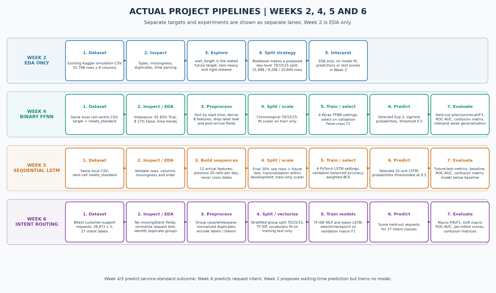

# Week 7 Technical Evidence Pack

This folder contains an implementation-specific pipeline flowchart, copies of existing project figures, verified intermediate results, suggested report snippets, and a screenshot checklist. Numbers below come from the saved notebooks and JSON result artifacts. The copied charts are existing experimental outputs; the flowchart is a process diagram, not a result plot. No screenshot is fabricated.

## Actual pipeline flowchart



Vector version: [actual_project_pipeline.svg](actual_project_pipeline.svg).

## Dataset and repository links

- Call-centre simulation dataset source documented in Week 2: <https://www.kaggle.com/datasets/jpmiller/call-centre-queue-simulation>
- Bitext dataset used in Week 6: <https://huggingface.co/datasets/bitext/Bitext-customer-support-llm-chatbot-training-dataset>
- Project repository: <https://github.com/BishwadeepRai/Smart-queue-Time-Management-system>

## Pipeline stages and purpose

### Week 2 — call-centre EDA only

1. **Dataset:** Read the existing Kaggle call-centre simulation CSV.
2. **Inspect:** Confirm dimensions, dtypes, missing values, duplicates, and parse timestamps for temporal analysis.
3. **EDA:** Explore `wait_length` as the stated prospective target, plus service duration and time patterns.
4. **Split strategy:** The notebook actually constructs a proposed chronological split at whole-day boundaries: train **31,898 rows**, validation **9,206**, and test **10,604**. This is exploratory split planning, not a model holdout experiment.
5. **Interpret:** Document findings and recommend chronological evaluation. **No Week 2 model is trained, and no test predictions or test metrics exist.** The later Week 4/5 binary classification task is not a fitted wait-time regression.

### Week 4 — feed-forward binary classifier

1. Read the shared CSV, combine date/start-time into a timestamp, and sort chronologically.
2. Inspect target balance and temporal/feature relationships.
3. Create the target from `meets_standard`; engineer eight queue-position/calendar features. Drop `wait_length` (it deterministically defines the label), `call_id`, and fields only known after service.
4. Split chronologically 70/15/15. Fit `StandardScaler` on training features only; transform validation and test.
5. Train four Keras dense-network settings with training class weights; choose using validation missed-class F1, then macro F1.
6. Predict held-out probabilities and threshold at 0.5.
7. Report classification metrics, positive-class ROC-AUC, confusion matrix, and the limitations evident in future-period performance.

### Week 5 — next-call sequence classifier

1. Read and validate the same CSV, parse and stably order call timestamps.
2. Engineer 12 prediction-time arrival/calendar features; exclude `wait_length`, identifiers, and post-arrival outcome fields.
3. Construct 20-call histories within each day; label each window with the following call's `meets_standard`. Result: **46,488 sequences**, tensor shape **(46,488, 20, 12)**.
4. Keep the final 20% of raw chronological rows as the future test targets; split development targets into train/validation in chronological order. Fit the scaler on **33,131 training-context rows only**.
5. Compare six PyTorch LSTM configurations and select by validation balanced accuracy, then accuracy/loss; train with weighted BCE.
6. Predict the future-period test set at threshold 0.5; compare against the training-majority baseline.
7. Report class-level and macro metrics, ROC-AUC, and confusion matrix. The saved result shows the LSTM did not beat the accuracy baseline.

### Week 6 — duplicate-aware multiclass intent routing

1. Load/cache the Bitext dataset; inspect **26,872 rows x 5 selected fields** and **27 intents**.
2. Check missing/empty values, class support and instruction lengths; normalize instructions by case-folding and collapsing whitespace.
3. Group normalized duplicates and verify label consistency; split **groups** into stratified 70/15/15 train/validation/test partitions, so normalized copies do not cross partitions. Fit the TF-IDF vocabulary on training text only. The token LSTM uses its existing training pipeline.
4. Train the existing TF-IDF MLP and token-sequence LSTM; select/checkpoint using validation macro F1.
5. Predict one of 27 intents on held-out requests.
6. Evaluate macro precision/recall/F1, one-vs-rest macro ROC-AUC, per-intent scores and confusion matrices.

### Purpose of the pipeline stages

| Stage | Purpose in this project |
|---|---|
| Dataset acquisition | Identify/load the actual source for that stage; Week 2/4/5 read the shared local CSV, while Week 6 loads or caches Bitext. |
| Inspection | Verify dimensions, schema, time/text validity, missingness, duplicates, class support and chronological order before modelling. |
| EDA | Describe target/feature distributions and project-specific patterns; it is the complete Week 2 deliverable, but only the diagnostic stage in Weeks 4–6. |
| Preprocessing | Transform raw values into prediction-time features or text tokens while excluding target leakage; handle repeated Week 6 requests before splitting. |
| Train/validation/test split | Isolate model fitting, model selection and final evaluation. Preserve chronology for the call-centre tasks and duplicate groups for Week 6. |
| Model training/selection | Fit the existing neural-network candidates and use validation criteria—not test performance—to select a configuration/checkpoint. |
| Predictions | Generate labels and/or class probabilities for held-out examples at the existing thresholds/class outputs. |
| Evaluation | Compare held-out predictions to true labels with the task-appropriate metrics, confusion matrices and ROC/AUC. |
| Interpretation | Explain what the evidence supports and its limits. In particular, Weeks 4/5 generalize poorly on future calls; Week 6's high scores are limited to its synthetic labeled corpus. |

## Intermediate evidence and actual outputs

### Dataset inspection and EDA

| Stage | Actual inspection / EDA output |
|---|---|
| Weeks 2/4/5 call-centre source | **51,708 rows x 9 source columns**; 2021-01-01 to 2021-12-31; 261 operating days. Week 2 notebook reports no missing values in the source fields and zero duplicate source rows. |
| Week 2 target and distributions | Stated target is continuous `wait_length`; mean is approximately **17 seconds**, median **0 seconds**, showing a zero-heavy/right-skewed distribution. This is not the binary target used later. |
| Week 2 proposed split | Whole-day chronological partition: train **31,898 (61.7%)**, validation **9,206 (17.8%)**, test **10,604 (20.5%)**. These are EDA/planning partitions only; Week 2 fits no model. |
| Weeks 4/5 classification target | `meets_standard`: **47,481 True (91.83%)**, **4,227 False (8.17%)**, about **11.23:1** imbalance. The identity `wait_length <= 60` exactly matches this label in all source rows. |
| Week 6 source | **26,872 rows x 5 fields**, **27 intents**; class counts range **950–1000**. Missing/empty counts are zero for the five inspected fields. |
| Week 6 normalized duplicates | **24,274 unique normalized request groups**, **1,187 repeated groups**, and **2,598 additional repeated rows**. The notebook checks that each normalized group has a single intent label. |

### Splits, preprocessing and model settings

| Stage | Split and preprocessing output |
|---|---|
| Week 4 | Chronological split: train **36,195** (missed 1,975; 5.46%), validation **7,756** (missed 1,007), test **7,757** (missed 1,245; 16.05%). Eight features; train-fitted scaler; seed 42. |
| Week 5 | **46,488 x 20 x 12** sequence tensor. Development has **29,540** training and **7,386** validation targets; future test has **9,562** targets. Training-only majority class is True (94.59%); future-test majority baseline accuracy is **84.06%**. |
| Week 6 | Group-stratified split: train **18,831 rows / 16,991 groups**, validation **4,010 / 3,641**, test **4,031 / 3,642**. TF-IDF fit only on train; 27 classes represented in each partition. Seed 42. |

| Model | Actual configuration / training evidence |
|---|---|
| Week 4 selected FFNN | Exp 2 — Increased capacity; dense widths **[64, 32]**, learning rate **0.001**, batch **32**, max epochs **30**, dropout **0.0**. Validation accuracy **0.3948**, missed-class F1 **0.2402**. Training history contains 30 epochs; training loss 0.6550 → 0.5276; validation loss 0.9715 → 0.9847. |
| Week 5 selected LSTM | 32 hidden units, 1 layer, learning rate 0.001, dropout 0.0, missed-class loss weight 8.0; validation balanced accuracy **53.4976%**, missed-class recall **58.9474%**, and accuracy **49.3095%** versus the validation-majority baseline **88.4240%**. Selected checkpoint epoch 1. The notebook retains the multi-configuration loss curves. |
| Week 6 MLP | TF-IDF unigrams/bigrams, up to 12,000 terms; dense layers 256 and 128 with dropout 0.35/0.25. Training loss over 6 epochs: 2.6557 → 0.0279; best validation macro F1 **0.9943**. |
| Week 6 LSTM | Token LSTM with 64-dimensional embedding, 64 hidden units and dropout 0.30. Training loss over 8 epochs: 2.0016 → 0.0263; best validation macro F1 **0.9918**. |

### Held-out results

Metrics are reported per task; scores across these different datasets/targets are **not a direct model comparison**. Binary AUC uses `True`/met-standard as the positive class; Week 6 uses one-vs-rest macro AUC.

**ROC plot convention:** Week 6's saved ROC figure draws micro-averaged multiclass curves. Its numeric `roc_auc_ovr_macro` in `week 6/outputs/week6_results.json` is a separate macro one-vs-rest summary. Label these distinctly in the report; do not call the plotted micro curve macro-averaged.

| Task/model | Accuracy | Macro precision | Macro recall | Macro F1 | ROC-AUC | Important interpretation |
|---|---:|---:|---:|---:|---:|---|
| Week 4 selected FFNN | 0.3753 | 0.5159 | 0.5246 | 0.3635 | 0.54042 | Missed recall 0.7446; test missed-class prevalence increases from 5.46% in train to 16.05% in test. |
| Week 5 selected LSTM | 0.7434 | 0.4939 | 0.4945 | 0.4938 | 0.48727 | Below the 84.06% training-majority test accuracy; missed-standard recall 0.1293. |
| Week 6 TF-IDF MLP | 0.9921 | 0.9922 | 0.9922 | 0.9921 | 0.99996 | High score on this synthetic/automatically labeled dataset; external validity is not established. |
| Week 6 PyTorch LSTM | 0.9883 | 0.9885 | 0.9883 | 0.9883 | 0.99991 | Evaluated on the same duplicate-aware holdout. |

### Confusion matrices (rows = actual; columns = predicted)

- Week 4 labels `[False, True]`: `[[927, 318], [4528, 1984]]`.
- Week 5 labels `[False (missed), True (met)]`: `[[197, 1327], [1127, 6911]]`.
- Week 6: use the saved per-model 27-class matrices in `week 6/outputs/week6_results.json` and the rendered figure below.

## Existing project visuals copied into this folder

These PNGs are copied from the weekly output folders without recreating or altering their experimental data:

| Asset | Evidence to show |
|---|---|
| [week2_wait_length_distribution.png](week2_wait_length_distribution.png) | Week 2 continuous waiting-time target distribution. |
| [week2_temporal_eda.png](week2_temporal_eda.png) | Week 2 temporal exploration. |
| [week2_chronological_ordering_finding.png](week2_chronological_ordering_finding.png) | Week 2 recorded warning/finding about chronology and random splitting. |
| [week4_target_class_distribution.png](week4_target_class_distribution.png) | Week 4 binary class imbalance. |
| [week4_daily_caller_by_target.png](week4_daily_caller_by_target.png) | Project-specific queue-position relationship. |
| [week4_selected_model_training_history.png](week4_selected_model_training_history.png) | Week 4 selected FFNN history. |
| [week4_test_confusion_matrix.png](week4_test_confusion_matrix.png) | Week 4 held-out confusion matrix. |
| [week4_test_roc_curve.png](week4_test_roc_curve.png) | Week 4 held-out ROC curve and AUC. |
| [week5_lstm_training_history.png](week5_lstm_training_history.png) | Week 5 configuration training/validation loss. |
| [week5_test_accuracy_and_confusion_matrix.png](week5_test_accuracy_and_confusion_matrix.png) | Week 5 future test versus baseline and confusion matrix. |
| [week5_test_roc_curve.png](week5_test_roc_curve.png) | Week 5 future-test ROC curve and AUC. |
| [week6_intent_distribution_and_duplicates.png](week6_intent_distribution_and_duplicates.png) | Week 6 class support and duplicate-request EDA. |
| [week6_test_confusion_matrices.png](week6_test_confusion_matrices.png) | Week 6 held-out confusion matrices for MLP and LSTM. |
| [week6_test_multiclass_roc_curves.png](week6_test_multiclass_roc_curves.png) | Week 6 micro-averaged multiclass ROC curves; the saved numeric AUC is macro one-vs-rest. |
| [week6_training_history.png](week6_training_history.png) | Week 6 saved model training histories. |

## Important code snippets to include (short excerpts only)

Use small snippets in the final report and cite the linked source file/cell. Do not paste the full notebook.

### 1. Week 4 chronological split, training-only scaling and model selection

Source: [`week 4/scripts/run_experiments.py`](../week%204/scripts/run_experiments.py).

```python
scaler = StandardScaler()
X_train = scaler.fit_transform(train[FEATURE_COLS])
X_val = scaler.transform(val[FEATURE_COLS])
X_test = scaler.transform(test[FEATURE_COLS])

best = max(experiment_results,
           key=lambda r: (r["val_metrics"]["f1_false"],
                          r["val_metrics"]["f1_macro"]))
```

**Why include it:** shows leakage-safe scaler fitting and that hyperparameter/model selection is performed on validation rather than the held-out test set.

### 2. Week 5 within-day sequence construction

Source: [`week 5/week5_rnn_lstm.ipynb`](../week%205/week5_rnn_lstm.ipynb), sequence preparation cells.

```python
SEQUENCE_LENGTH = 20
window_positions_list, target_positions_list = [], []
for day_positions in raw_df.groupby("date", sort=False).indices.values():
    day_positions = np.asarray(day_positions, dtype=np.int64)
    for next_offset in range(SEQUENCE_LENGTH, len(day_positions)):
        window_positions_list.append(
            day_positions[next_offset - SEQUENCE_LENGTH:next_offset])
        target_positions_list.append(day_positions[next_offset])
```

**Why include it:** explains what one supervised sample means and why sequence boundaries preserve the project's event chronology. Pair it with the actual tensor shape (46,488, 20, 12).

### 3. Week 6 normalized duplicate groups and grouped stratified split

Source: [`week 6/week6_customer_support_intent_classification.ipynb`](../week%206/week6_customer_support_intent_classification.ipynb), split/preprocessing cells.

```python
normalized_instructions = (
    df["instruction"].astype(str).str.casefold()
    .str.replace(r"\s+", " ", regex=True).str.strip()
)
instruction_groups, unique_instructions = pd.factorize(
    normalized_instructions, sort=False)
if (group_summary["label_count"] != 1).any():
    raise ValueError("A normalized customer instruction maps to multiple intent labels.")
```

**Why include it:** demonstrates the control for exact case/whitespace duplicates that would otherwise inflate held-out performance.

### 4. Week 5 training-only scaling and Week 6 group split

```python
training_feature_positions = np.unique(window_positions[train_idx].reshape(-1))
scaler.fit(feature_matrix[training_feature_positions])

train_groups, holdout_groups = train_test_split(
    all_group_ids, test_size=0.30, random_state=SEED, stratify=group_y)
```

**Why include it:** documents the Week 5 train-context-only scaler and the Week 6 stratified group-level split. In the report, clarify these are snippets from separate notebooks.

### 5. Week 6 train-only TF-IDF vocabulary

```python
X_train_tfidf = vectorizer.fit_transform(texts[train_idx])
X_valid_tfidf = vectorizer.transform(texts[valid_idx])
X_test_tfidf = vectorizer.transform(texts[test_idx])
```

**Why include it:** shows that the vocabulary/statistics are learned from training text only and reused for validation/test.

### 6. Final held-out metrics and ROC

Source: Week 4 experiment runner, Week 5 final evaluation notebook cell, and Week 6 evaluation cells/results JSON.

Include a compact metric computation/evaluation excerpt for the specific task, then show its actual confusion-matrix and ROC figures. For Week 6 describe ROC as one-vs-rest macro AUC; do not present it as binary ROC.

## Recommended screenshots to capture from the real executed project

Screenshots below are **to be captured by the student from the actual notebook/terminal**. They are recommendations, not generated evidence.

| Suggested filename | Capture in the project | What the screenshot should show |
|---|---|---|
| `screenshot_week2_dataset_audit.png` | Week 2 executed notebook, load/quality/date cells | Shape 51,708 x 9, parsed date range, zero missing values and zero duplicate rows. |
| `screenshot_week2_wait_length_eda.png` | Week 2 executed notebook, target distribution/temporal EDA | `wait_length` distribution and a temporal chart; label it as EDA, not model evaluation. |
| `screenshot_week2_proposed_chronological_split.png` | Week 2 split-strategy cell | Day-level proposed train/validation/test row counts; make clear no model was trained in Week 2. |
| `screenshot_week4_preprocessing_split.png` | Week 4 runner/notebook code and split output | Target-leak exclusions, chronological split, train-only scaler fit and 70/15/15 counts. |
| `screenshot_week4_selected_model_history.png` | Week 4 experiment output | Selected Exp 2 configuration and training/validation history. |
| `screenshot_week4_test_evaluation.png` | Week 4 saved final output/figures | Test precision/recall/F1, AUC 0.5404 and matching confusion/ROC figures. |
| `screenshot_week5_sequence_pipeline.png` | Week 5 executed notebook sequence and split cells | (46,488, 20, 12) tensor, within-day windowing, scaler fit rows 33,131 and future-test split. |
| `screenshot_week5_model_selection_history.png` | Week 5 notebook selected-experiment output | Selected 32-unit LSTM, weight 8, validation selection/checkpoint and loss curves. |
| `screenshot_week5_future_test_results.png` | Week 5 final evaluation cells | 74.34% vs 84.06% baseline, missed-class metrics, confusion matrix and AUC 0.4873. |
| `screenshot_week6_duplicate_aware_split.png` | Week 6 executed notebook EDA and split cells | 1,187 duplicate groups, grouped 70/15/15 counts and proof groups are disjoint. |
| `screenshot_week6_model_results.png` | Week 6 notebook held-out evaluation | MLP/LSTM metrics and per-intent report. |
| `screenshot_week6_confusion_roc.png` | Week 6 saved evaluation figures | Both 27-class confusion matrices and micro-averaged ROC curves; distinguish the curve from macro one-vs-rest AUC in the JSON. |
| `screenshot_project_repository_files.png` | VS Code Explorer or GitHub repository page | Actual week folders, report, outputs, and project link. |

Avoid screenshots that hide code context, crop metric labels, or show unexecuted cells as results. Keep raw identifiers/customer-like text out of screenshots where unnecessary.

## Evidence source files

- [`week 4/results.json`](../week%204/results.json)
- [`week 5/outputs/week5_results.json`](../week%205/outputs/week5_results.json)
- [`week 6/outputs/week6_results.json`](../week%206/outputs/week6_results.json)
- Executed notebooks and original image folders under `week 2/`, `week 4/`, `week 5/`, and `week 6/`.

Regenerate copied figures and the pipeline diagram from the repository root:

```powershell
python "report_assets/build_report_assets.py"
```
